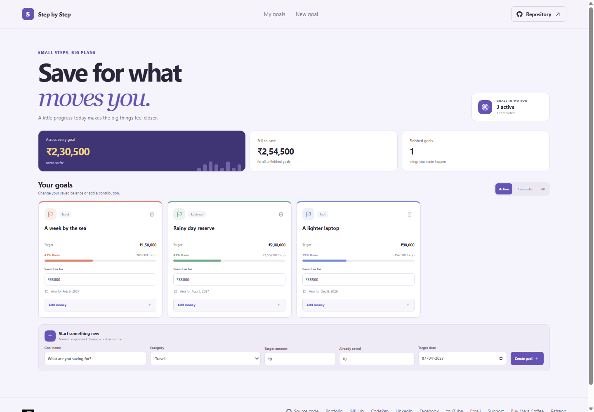

# Step by Step: Savings Goal Tracker

Step by Step keeps savings targets, due dates, and contributions together so progress is easy to check and update.

**GitHub Pages URL:** https://a2rp.github.io/savings-goal-tracker/ (planned after deployment)

## Included

- Create a savings goal with a category, target, saved balance, and target date.
- Track progress and remaining amount across active goals.
- Add a contribution or directly adjust a saved balance.
- Filter goals by active, complete, or all.
- Confirm before removing a goal and its saved progress.

## How to use it

Update a goal's saved balance or add a contribution from its card. Use the filters to review active and completed plans. Create another goal in the form below the list.

## Data and limits

Goals are stored in this browser with localStorage and do not sync to another browser or device. The sample goals are editable demonstration data. Amounts use Indian rupees.

## Run locally

Run npm install, then npm run dev to start the Vite development server.

## Checks and deployment

Run npm run lint and npm run build before deployment. Run npm run deploy to publish the dist directory to the gh-pages branch after configuring the public repository as origin and enabling GitHub Pages for that branch.

## Future improvements

Ideas only. These are not implemented yet:

- Add a monthly contribution history for each goal.
- Export a savings summary as a printable report.
- Add optional reminders for upcoming target dates.

## Links

- Portfolio: [https://www.ashishranjan.net](https://www.ashishranjan.net)
- GitHub: [https://github.com/a2rp](https://github.com/a2rp)
- CodePen: [https://codepen.io/ash1198](https://codepen.io/ash1198)
- LinkedIn: [https://www.linkedin.com/in/aashishranjan](https://www.linkedin.com/in/aashishranjan)
- Facebook: [https://www.facebook.com/theash.ashish/](https://www.facebook.com/theash.ashish/)
- YouTube: [https://www.youtube.com/@ashishranjan-ashz?sub_confirmation=1](https://www.youtube.com/@ashishranjan-ashz?sub_confirmation=1)
- Email: [mailto:ash.ranjan09@gmail.com](mailto:ash.ranjan09@gmail.com)

## Support

- Support: [https://a2rp-donation-page.netlify.app/](https://a2rp-donation-page.netlify.app/)
- Buy Me a Coffee: [https://buymeacoffee.com/ashishranjan](https://buymeacoffee.com/ashishranjan)
- Patreon: [https://www.patreon.com/ashishranjan](https://www.patreon.com/ashishranjan)